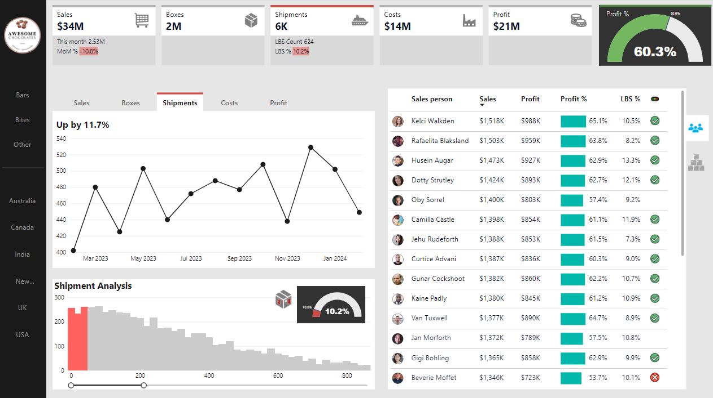

# Power BI Sales Performance Dashboard

## Project Overview
This portfolio project showcases an interactive Power BI sales analytics dashboard based on the Awesome Chocolates sample dataset. The dashboard helps visualize sales performance, profitability, shipment trends, and salesperson performance.

## Dashboard Preview

## Key Performance Indicators (KPIs)

| Metric | Value |
|---|---|
| Total Sales | $34M |
| Total Profit | $21M |
| Profit Margin | 60.3% |
| Total Shipments | 6K |
| Boxes Sold | 2M |
| Total Costs | $14M |

## Dashboard Features

- Sales, profit, cost, and shipment performance monitoring
- Monthly performance trends
- Salesperson performance comparison
- Profit margin analysis
- Shipment distribution and low-box shipment analysis
- Country and product-category filters

## Tools and Technologies

- Microsoft Power BI
- Data Visualization
- Business Intelligence Reporting
- KPI Analysis
- Sales Performance Analytics

## Business Value

The dashboard demonstrates how sales and operational data can be presented to help stakeholders monitor business performance, compare salesperson profitability, identify shipment trends, and explore performance across markets.

## Project Source and Attribution

This project is based on the Awesome Chocolates Power BI dashboard tutorial and sample resources provided by Chandoo.

Original creator: [Chandoo](https://github.com/chandoo-org/Power-BI)

Tutorial: [YouTube](https://youtu.be/ooJO7NW4uJU)

Dashboard screenshot and sample materials are credited to their original creator. This repository is presented as a tutorial-based portfolio study.
